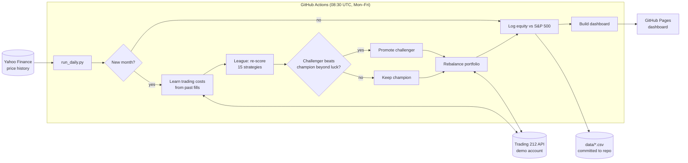

# Automated ETF trading bot

[](https://github.com/OlafMadzia/trading-bot/actions/workflows/tests.yml)
[](https://github.com/OlafMadzia/trading-bot/actions/workflows/daily.yml)

A fully automated paper-trading system that researches, selects and trades an
ETF strategy on a Trading 212 demo account, then checks honestly whether it does
better than simply holding the S&P 500.

**📊 Live results dashboard: https://olafmadzia.github.io/trading-bot/**

- Runs itself every weekday on GitHub Actions: no server, no manual steps
- Trades real (paper) orders through the Trading 212 API
- Every month re-evaluates 15 strategies, including a machine-learning model, and
  only switches when the evidence is statistically strong
- Learns its real trading costs from its own order fills
- Every result is reproducible from the research scripts in this repo

## Key findings

| Question | Answer |
|---|---|
| Do candlestick patterns predict prices? | **No.** 24 patterns, 40 instruments, 26 years, ~256k occurrences: none of the classic reversal patterns worked as claimed in both decades tested. |
| Does machine learning beat simple rules? | **No.** A gradient-boosting model retrained monthly was significantly *worse* than plain momentum out-of-sample (paired t = -2.4). |
| Does switching to the best recent strategy help? | **No, it hurts.** The faster a meta-learner chases recent winners, the worse the results. |
| What does work? | **Momentum rotation** (hold the 5 strongest of 10 asset classes, only while they're in an uptrend): similar long-run return to the S&P 500 with about a third of the worst drawdown (-16% vs -55%). |

Full method and results: **[RESEARCH.md](RESEARCH.md)**

## How it works



1. **Data:** daily price history for 16 US-listed ETFs (long, clean histories) from Yahoo Finance.
2. **Signals:** strategies decide target weights from data up to the last completed month-end.
3. **Champion/challenger league** (`bot/league.py`): each month every strategy is re-scored on
   the last 10 years. A challenger replaces the live strategy only if it wins on a paired
   t-test (t > 2), has a better Sharpe ratio in *both* halves of the window, and doesn't
   have a much deeper drawdown. This guards against switching to a strategy that was just lucky.
4. **Execution:** UK investors can't buy US-listed ETFs, so each signal maps to a UK-listed
   equivalent tracking the same index (e.g. SPY → VUSA). Orders are sized from live prices, sells
   go before buys, and the bot handles partial fills, rate limits and cash reserved for pending orders.
5. **Cost learning:** each order's fill price and fees come back from Trading 212. The measured
   cost per trade feeds the next month's league, so the backtests use realistic costs.
6. **Reporting:** equity, trades, league and strategy history are committed to `data/` and
   rendered to the dashboard.

## Avoiding fooling yourself

Most trading backtests look great because they accidentally use future information or
are tuned until they fit the past. This project guards against both:

- **No look-ahead:** a decision made at day *t*'s close only earns returns from *t+1*.
  The test suite proves it: it rewrites the "future" of the price data and checks that no
  earlier decision changes, for every strategy *and* for the ML model's training.
  The tests themselves were checked by injecting a deliberate leak and confirming they fail.
- **Out-of-sample testing:** results must hold in two separate periods, not just overall.
- **No parameter tuning:** textbook settings only, with a robustness grid showing nearby
  settings give similar results.
- **Statistical bar for changes:** paired t-tests vs the current strategy, not "which number is biggest".
- **Costs included**, and measured from real fills rather than guessed.

## Tech stack

Python · pandas · NumPy · scikit-learn · Trading 212 REST API · yfinance ·
GitHub Actions (scheduled jobs + CI) · GitHub Pages · pytest

## Project structure

```
bot/
  t212.py         Trading 212 API client (demo only, enforced)
  data.py         Price data loading and caching
  strategies.py   15+ strategies: momentum, trend, risk parity, Keller VAA/DAA, ...
  backtest.py     Weight-based backtester with costs; performance stats
  candles.py      24 candlestick / price-action pattern detectors
  ml.py           Walk-forward gradient-boosting / ridge asset ranker
  meta.py         Meta-learners (Hedge algorithm, top-k) over strategies
  league.py       Champion/challenger selection with significance tests
  live.py         Daily runner: cost learning, league, rebalancing, logging
  report.py       Builds the dashboard (docs/index.html)
tests/            pytest suite (look-ahead, costs, ML leakage, league rules)
run_daily.py      Entry point for the scheduled job
run_backtests.py  Round 1 research: 17 strategies vs S&P 500
run_candles.py    Candlestick pattern event study
run_research.py   Round 2: published models, ML, meta-learners
RESEARCH.md       Methods and findings
```

## Running it yourself

```bash
python -m venv .venv
.venv/Scripts/pip install -r requirements.txt pytest   # Windows; use .venv/bin on macOS/Linux
.venv/Scripts/python -m pytest                          # run the tests
.venv/Scripts/python run_backtests.py                   # reproduce the research
```

Live trading needs a Trading 212 **demo** API key in a `.env` file
(`T212_API_KEY`, `T212_API_SECRET`, `T212_ENV=demo`). The client refuses to run against a live account.

*Paper trading only. Nothing here is investment advice.*
